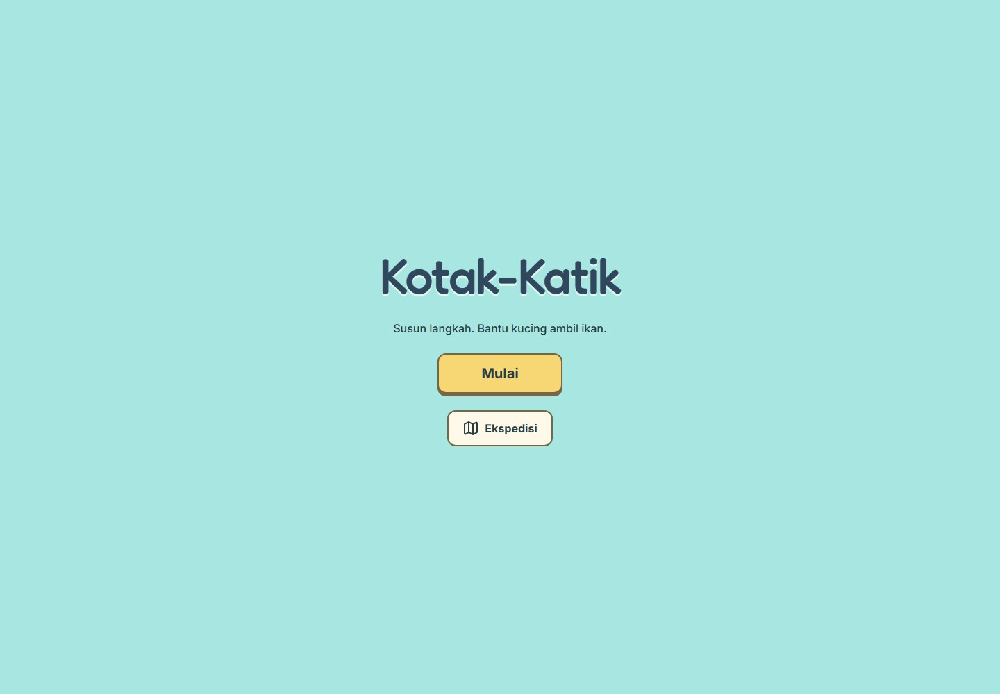
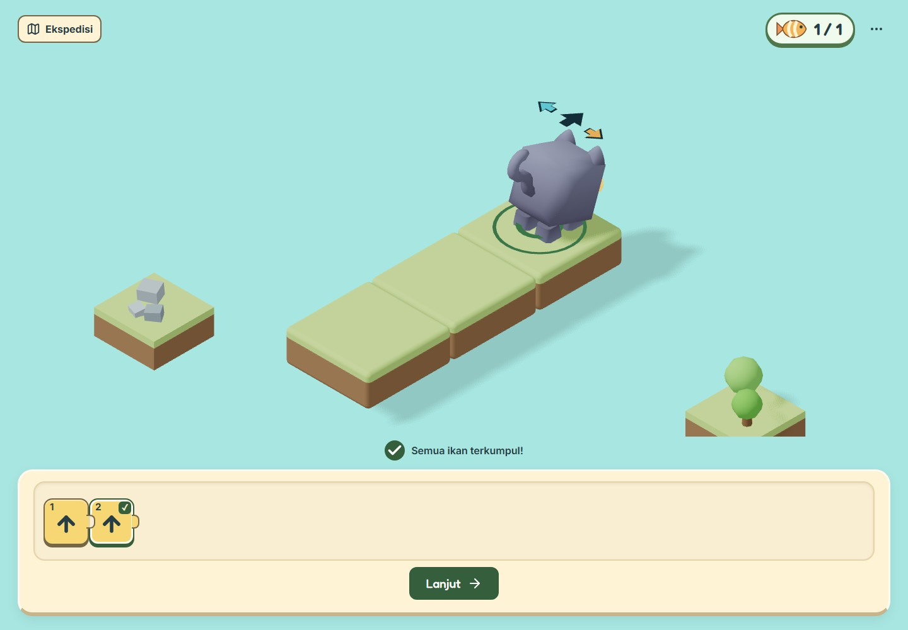

# Kotak-Katik

Kotak-Katik adalah game edukasi berbasis web untuk siswa kelas 3–6 SD yang memperkenalkan computational thinking melalui permainan menyusun perintah, mengarahkan kucing mengambil ikan, serta menyelesaikan tantangan logika secara bertahap.

Dibuat untuk M-ONE Telkomsel Coding Competition 2026, tema **Web Education for Kids**.

**Mainkan:** [kotak-katik.henix.my.id](https://kotak-katik.henix.my.id)
**Repositori publik:** [justhenix/kotak-katik](https://github.com/justhenix/kotak-katik)
**Alamat sekunder:** [kotak-katik.vercel.app](https://kotak-katik.vercel.app)

## Mengapa Kotak-Katik?

Urutan dan pengulangan dapat diamati ketika sebuah instruksi menghasilkan tindakan konkret. Anak menyusun blok, melihat kucing bergerak, lalu memperbaiki langkah jika hasilnya belum sesuai. Permainan memberi ruang berpikir, bereksperimen, dan mencoba kembali.

**Rencanakan → Susun perintah → Jalankan → Amati → Perbaiki → Coba lagi.**

## Pengguna dan tujuan belajar

Untuk siswa SD umum kelas 3–6 yang mampu membaca instruksi pendek berbahasa Indonesia. Pengalaman pemrograman tidak diperlukan.

Konsep yang diperkenalkan: sequencing, algorithmic thinking, arah relatif, repetition/loops, debugging, serta penalaran logis dan pemecahan masalah. Ini tujuan rancangan pembelajaran; efektivitasnya belum diukur melalui uji kelas.

Pada **15 Oktober 2026**, sasaran ditetapkan dari fokus pendidikan khusus sebelumnya menjadi SD umum kelas 3–6. Mekanik dan kurikulum dipertahankan. Prompt, keputusan, dan laporan lama tetap menjadi bukti sejarah.

## Gameplay dan fitur

- 16 tahap tetap: gerak, urutan, belokan, jalur gabungan, Ulangi, debugging, dan tantangan campuran.
- Blok Maju, Kiri, Kanan, dan Ulangi 2–4 kali; isi Ulangi berupa perintah primitif.
- Maju mengikuti arah hadap kucing; belokan berputar di tempat.
- Eksekusi program, penanda blok/iterasi aktif, tabrakan, retry, dan inspeksi satu langkah sesuai fase belajar.
- Ekspedisi, pembukaan tahap, replay, layar akhir, progres lokal dan resume setelah refresh.
- Kontrol ketuk/keyboard, tampilan responsif, reduced motion, dan informasi tanpa ketergantungan audio.
- Diorama low-poly dengan kucing/ikan terkurasi dan foliage prosedural asli proyek.

## Cara bermain

1. Tekan **Mulai** dan amati contoh pertama. **Lanjutkan** tersedia saat ada progres.
2. Pilih slot **+**, lalu tambahkan perintah yang tersedia.
3. Perhatikan arah hadap kucing sebelum memilih Maju, Kiri, atau Kanan.
4. Jalankan susunan dan amati ikan serta blok aktif.
5. Jika belum berhasil, periksa hasil, ubah perintah, lalu coba lagi. **Satu langkah** diperkenalkan pada debugging dan tantangan campuran.
6. Selesaikan program valid dengan seluruh ikan terkumpul untuk membuka tahap berikutnya.

Contoh dapat diulang/dilewati melalui menu. Skip membuka kelanjutan tanpa mencatat completion. Ekspedisi membedakan tahap terkunci, terbuka, saat ini, dan selesai.

Progres disimpan pada browser yang sama; program dan eksekusi dibuat ulang saat masuk tahap. Jika storage ditolak, permainan sesi tetap berjalan dengan pemberitahuan visual. Hapus progres melalui **Ekspedisi → Progres → Mulai dari awal → Hapus progres**; Batal mempertahankannya.

## I Do / We Do / You Do

**I Do:** contoh otomatis memakai interpreter permainan yang sama. Anak mengamati perintah dan hasil.

**We Do:** program awal dan petunjuk mengarahkan satu tindakan pada satu waktu. Anak melihat hasil percobaannya sebelum memperbaiki.

**You Do:** anak menyusun solusi mandiri ketika bantuan prosedural berkurang. Orientasi dan umpan balik tetap tersedia.

## Teknologi dan arsitektur

Bun, Vite, React, TypeScript, Three.js/React Three Fiber, Zustand, Tailwind CSS, Lucide React, Fredoka/Inter, Vitest, dan Playwright. Versi aktual tercatat dalam [package.json](package.json) dan bun.lock.

src/game/ memuat simulasi murni dan kurikulum; src/stores/ mengelola editor, eksekusi, tutorial, navigasi, dan progres; src/components/ menyediakan kontrol DOM; src/scene/ menampilkan state. Aturan gerak, ikan, tabrakan, dan completion diputuskan simulasi.

Tidak ada backend atau API key. Progres memakai localStorage versi 1. WebGL diperlukan. Perangkat fisik, sesi screen reader nyata, serta pemahaman peserta didik belum divalidasi.

## Menjalankan lokal

Pasang Bun, lalu:

~~~sh
bun install --frozen-lockfile
bun run dev
~~~

Build produksi:

~~~sh
bun run build
bun run preview
~~~

## Pengujian

~~~sh
bun run test
bun run build
bun x playwright install chromium
bun x playwright test e2e/journey.spec.ts
~~~

Browser lokal memakai hasil production build. Preview teknik: /?fixture=kernel, /?fixture=turning, /?fixture=loops, atau /?level=m2-right-together. Preview tidak memberikan progres Ekspedisi.

Pemeriksaan deployment dari PowerShell:

~~~powershell
$env:MVP_BASE_URL = 'https://kotak-katik.henix.my.id'
bun x playwright test e2e/journey.spec.ts --config playwright.release.config.ts
Remove-Item Env:MVP_BASE_URL
~~~

Pada pemeriksaan final 15 Oktober, **264 unit test dan production build lulus**. Sepuluh pemeriksaan browser custom domain lulus, termasuk perjalanan seluruh 16 tahap dengan input mobile, title/tutorial, Ekspedisi, persistensi, dan viewport 1440/390/320. Suite mechanics lama memiliki selector yang mengasumsikan palette terbuka sebelum slot dipilih dan belum disesuaikan dengan UI saat ini; hasilnya tidak diklaim lulus. Detail verifikasi tercatat pada [development log](docs/DEVELOPMENT_LOG.md). Advisory ukuran chunk renderer Vite tetap muncul.

## Screenshot dan bukti

Gambar berasal dari sesi browser lokal 15 Oktober 2026. Konteks tiap gambar tersedia pada [indeks screenshot](screenshots/README.md).

[Bukti mobile](screenshots/08-forward-puzzle-mobile.jpg) dan [laporan milestone M3](docs/M3_MVP_SPRINT.md) menyediakan bukti tambahan bertanggal.

## Pengembangan berbantuan AI

AI membantu implementasi, debugging, audit, dan verifikasi berdasarkan batas produk. Developer meninjau hasil; prompt dan Git history dipertahankan agar proses dapat diperiksa.

Lima Docs Acuan AI yang diunggah langsung sebagai Markdown:

1. [product.md](.agents/product.md): MDS/PRD, sasaran, scope, acceptance.
2. [pedagogy.md](.agents/pedagogy.md): kurikulum dan gradual release.
3. [gameplay.md](.agents/gameplay.md): mekanik dan progres.
4. [design.md](.agents/design.md): UI/UX dan aksesibilitas.
5. [technical.md](.agents/technical.md): arsitektur, kualitas, test, deployment.

[AGENTS.md](AGENTS.md) adalah panduan root, bukan unggahan keenam. Panduan aksesibilitas dan quality bar lama digabung ke design/technical; versi sebelumnya tetap di Git.

[Jurnal prompt terkurasi](docs/PROMPT_JOURNAL.md) adalah **satu berkas dengan lima prompt autentik**. [Raw prompt log](docs/PROMPT_LOG.md) dan [development log](docs/DEVELOPMENT_LOG.md) menyimpan sejarah. Format pengumpulan tetap Markdown; tidak dibuat PDF/DOCX. Ekstensi unggahan harus diverifikasi pada formulir resmi.

## Rilis, credits, dan lisensi

Rilis mempertahankan game saat ini. Akun, multiplayer, AI chat, dashboard, ekonomi, editor level, loop bersarang, audio, dan tema baru di luar scope.

Vercel menggunakan frozen install, build, dan output dist sesuai [vercel.json](vercel.json). Custom domain dan alur game diperiksa langsung pada 15 Oktober 2026. Pengiriman formulir merupakan langkah terpisah dari deployment.

[Atribusi lengkap](docs/ATTRIBUTIONS.md), [kontrak aset](docs/ASSETS.md), serta [lisensi runtime](public/licenses) tersedia. Kucing: Kenney Cube Pets (CC0). Clownfish: Quaternius (CC0). Alternatif trout: Poly by Google (CC BY 3.0). Pointer: Kenney Cursor Pack (CC0). Fredoka/Inter: OFL. Pemberitahuan paket runtime disertakan; lisensi pihak ketiga berlaku terpisah dari kode. Foliage judul/gameplay dibuat secara prosedural dalam proyek.
