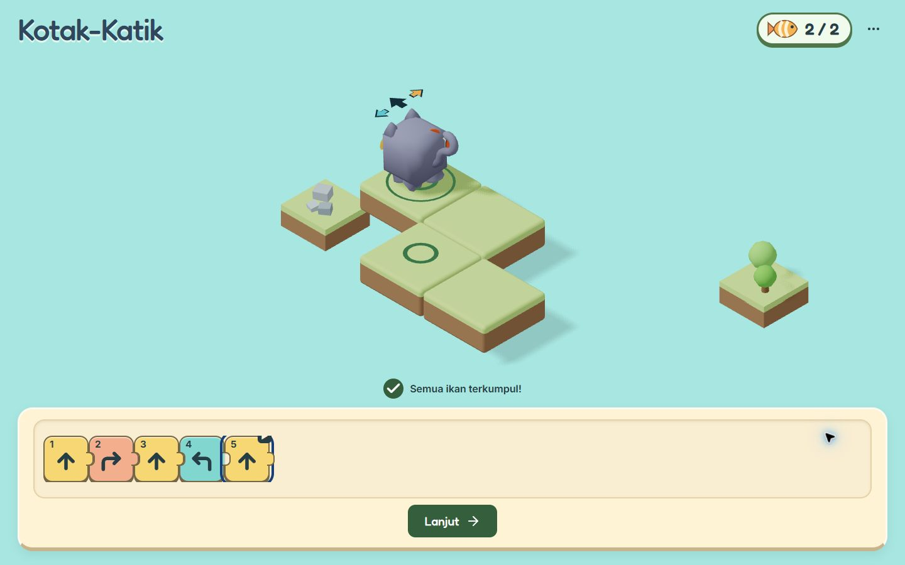
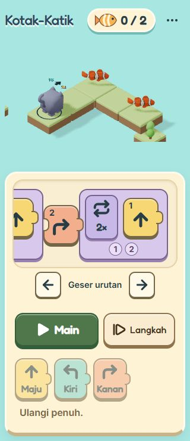

# M2B visual UX fix report

Date: 2026-10-13 (Asia/Jakarta)  
Scope: M2B stabilization on the existing 16-stage game  
Verdict: **GO for the M2B visual fix pass**, subject to the final verification recorded below.

The earlier playtest report was read from `D:/Dev/Worktrees/Codex/225d/KotakKatik/docs/M2B_PLAYTEST_REPORT.md`; it is absent from this primary checkout. Its gameplay coverage was useful, but its visual GO missed clipping, the native count menu, and mobile composition problems. Before captures use that untouched worktree at the same `57c88d3` checkpoint, served on port 5176. After captures use this checkout on port 5174.

## Changes and root causes

1. **Tray clipping:** the overflow viewport originally enclosed connectors, external badges, and outlines without sufficient scrolling-content padding. Padding now lives in an inner strip, including the final connector. State badges sit inside blocks. Reveal logic includes a complete Repeat container when it fits, handles a full scope whose insertion slot disappears, and returns to the beginning on completion. Resize and keyboard focus keep the relevant block visible. Long trays have labeled, 44px navigation buttons.
2. **Mobile composition:** the board uses the space left by the actual editor instead of a fixed mobile height. The program scrolls separately from execution controls. Main and Langkah occupy a stable row directly after the program; expanded editing tools follow it. Command choices fit across narrow screens, and controls grow or wrap with enlarged text. DOM order follows the mobile interaction order.
3. **Repeat count:** the native select is replaced with a lavender `− / 2× / +` counter for 2–4. Both buttons remain visible at the limits. Each is 44×44px. Arrow keys, Home, End, Enter/Space and Escape work. Bound buttons use `aria-disabled` so keyboard focus survives reaching a limit; a full tray retains editor focus on Escape and keeps the ready Play control available.
4. **Visual states:** selection uses an inset ink rim and check; keyboard focus uses an external ink dashed ring; the execution trace uses a green rim, cream inset and play marker; failure uses a red rim and `!`; completion uses a green check. Tutorial cues use earth-colored dots and the original Kenney hand, without the blue rectangle around the whole palette. Count guidance points below the number so it stays readable. Existing cat movement, pointer travel/taps, arrival animation and reduced-motion behavior remain.
5. **Spacing and completion:** connectors, loop iteration numbers, focus outlines and completion actions have edge clearance. Completion clears the scrolling position and leaves explicit navigation for longer programs. Next-stage focus excludes disabled controls.

The interpreter, simulation, level definitions, curriculum order, command unlocks, authored lesson data, assets and dependencies are unchanged. Relevant code is in `ProgramTray.tsx`, `RepeatCounter.tsx`, `RunControls.tsx`, `GhostHand.tsx`, `LessonScaffold.tsx`, and `src/styles/index.css`.

## Direct before/after evidence

These are game screenshots from Codex Browser Computer Use, without browser chrome or an emulator workspace. Sizes refer to verified CSS viewport dimensions. The Chrome profile's existing zoom was accounted for when setting the viewport and capturing the game area.

| View and issue | Before | After |
| --- | --- | --- |
| 1440×900, five-command completion: cropped execution badge/outline | [Before](evidence/m2b-visual-fix/before-desktop-completed.jpg) | [After](evidence/m2b-visual-fix/after-desktop-completed.jpg) |
| 1440×900, Repeat editing | [Native control](evidence/m2b-visual-fix/before-desktop-repeat.jpg) | [Counter](evidence/m2b-visual-fix/after-desktop-repeat.jpg), [4× limit and focus](evidence/m2b-visual-fix/after-desktop-repeat-limit.jpg) |
| 390×844, prepared Repeat at 3× | [Before](evidence/m2b-visual-fix/before-mobile-repeat-3.jpg) | [After](evidence/m2b-visual-fix/after-mobile-repeat-focus.jpg) |
| 320×740, empty mixed stage | [Wrapped choices](evidence/m2b-visual-fix/before-narrow-initial.jpg) | [After](evidence/m2b-visual-fix/after-narrow-initial.jpg) |
| 320×740, two Repeats and a turn | [Before](evidence/m2b-visual-fix/before-narrow-mixed-edit.jpg) | [After](evidence/m2b-visual-fix/after-narrow-mixed-edit.jpg) |

Desktop completion, before:

Desktop completion, after:

Narrow mobile, after:

## Operated and visually checked

| Interaction | Result and evidence |
| --- | --- |
| Normal placement, selection and keyboard focus | Built Forward–Right–Forward–Left–Forward. Selected and focused the turn, executed it, collected both fish and advanced. [Selection/focus](evidence/m2b-visual-fix/after-desktop-selection-focus.jpg). |
| Long sequence | Added 12 Left blocks in the existing turning fixture. Inspected both ends and selected block 12 by keyboard. Main remained visible. The expanded fixture toolbar required one short vertical scroll to its palette. [Start](evidence/m2b-visual-fix/after-narrow-long-start.jpg), [end](evidence/m2b-visual-fix/after-narrow-long-end.jpg), [selected](evidence/m2b-visual-fix/after-narrow-long-selection.jpg), [scrolled](evidence/m2b-visual-fix/after-narrow-long-selection-scrolled.jpg). |
| Repeat editing and active states | Selected the header, tried 2–4, used keyboard shortcuts, checked the inactive boundary button, then solved at 3×. The counter is always visible during editing; it has no popup state. [390px](evidence/m2b-visual-fix/after-mobile-repeat-focus.jpg), [320px](evidence/m2b-visual-fix/after-narrow-repeat-resized.jpg). |
| Running, failure and inspection | Ran 4× Forward on `m2-debug-alone`: both fish were collected, then iteration 4 failed. The failing block and feedback persisted; progression stayed unavailable. Used Periksa satu per satu and Step, changed to 3×, retried and advanced. [Running](evidence/m2b-visual-fix/after-narrow-running.jpg), [failure](evidence/m2b-visual-fix/after-narrow-failure.jpg), [Step](evidence/m2b-visual-fix/after-narrow-step.jpg). |
| Completion and final progression | Solved the final mixed program. Inspected the first and last Repeat after completion using tray navigation. [First end](evidence/m2b-visual-fix/after-narrow-completed-start.jpg), [last end](evidence/m2b-visual-fix/after-narrow-completed-end.jpg), [mobile Lanjut](evidence/m2b-visual-fix/after-mobile-completed.jpg). |
| Tutorial and responsive resizing | Observed automatic Repeat placement and the original hand. Resized with count editing and Play visible through 1440×900, 390×844 and 320×740; the cue followed actual control bounds. [Desktop tutorial](evidence/m2b-visual-fix/after-desktop-tutorial.jpg), [count cue](evidence/m2b-visual-fix/after-mobile-repeat-2.jpg). |

Ordinary retested curriculum screens fit their viewport vertically and have no page-wide horizontal overflow. Long content scrolls inside the tray; offscreen blocks are deliberately indicated by navigation. Measured counter targets are 44×44px. Main text contrast is 5.16:1, Stop text is 5.22:1, and ink focus against cream is 10.37:1.

The native Windows helper stopped because it could not establish Chrome's URL confidently. No further native Windows input was used. Required game operation and captures used Browser Computer Use bound to the explicit localhost tab.

## Regression checks

- `bun run test`: **227 passed**, nine files.
- `bun run build`: **passed**, including TypeScript. The existing renderer bundle advisory remains; final JavaScript is approximately 346 kB gzip.
- Existing 76-check E2E run: **74 passed**, including all 16 stages on desktop and mobile. It caught two introduced regressions: Step text at 200% size and focus lost at the Repeat limit. Both were repaired.
- Focused repair run: **16 passed**, covering those failures, editing, text zoom, replay/skip, pointer reflow and new tray/count regressions.
- Placement/progression and visual regression run after the mobile control reorder: **8 passed**.
- Final full-tray counter Escape check: pending final result.
- Existing E2E helpers now operate the real counter instead of `selectOption`. No gameplay checks were removed.

## Remaining issues and decision

No known P0/P1 visual usability defect remains in the retested curriculum views. Existing decorative mini-islands can crop at canvas boundaries in narrow views; playable tiles, fish, the cat and orientation remain readable. Expanded engineering-fixture toolbars and 200% text size can need vertical scrolling. Physical devices and comprehension with SDLB-B children/teachers have not been tested.

The visual stabilization verdict is **GO** once the final counter check above passes. This is not approval to commit, push, deploy, or start M3. No Git history was changed, and all work remains uncommitted for review.
